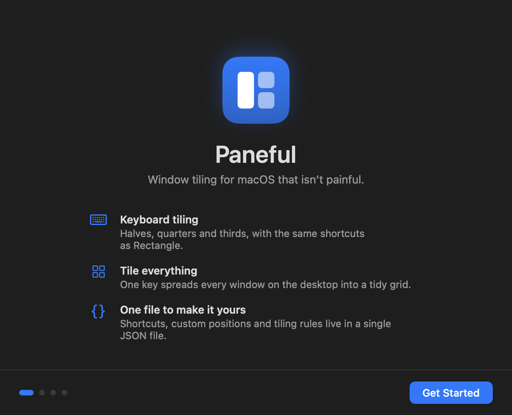
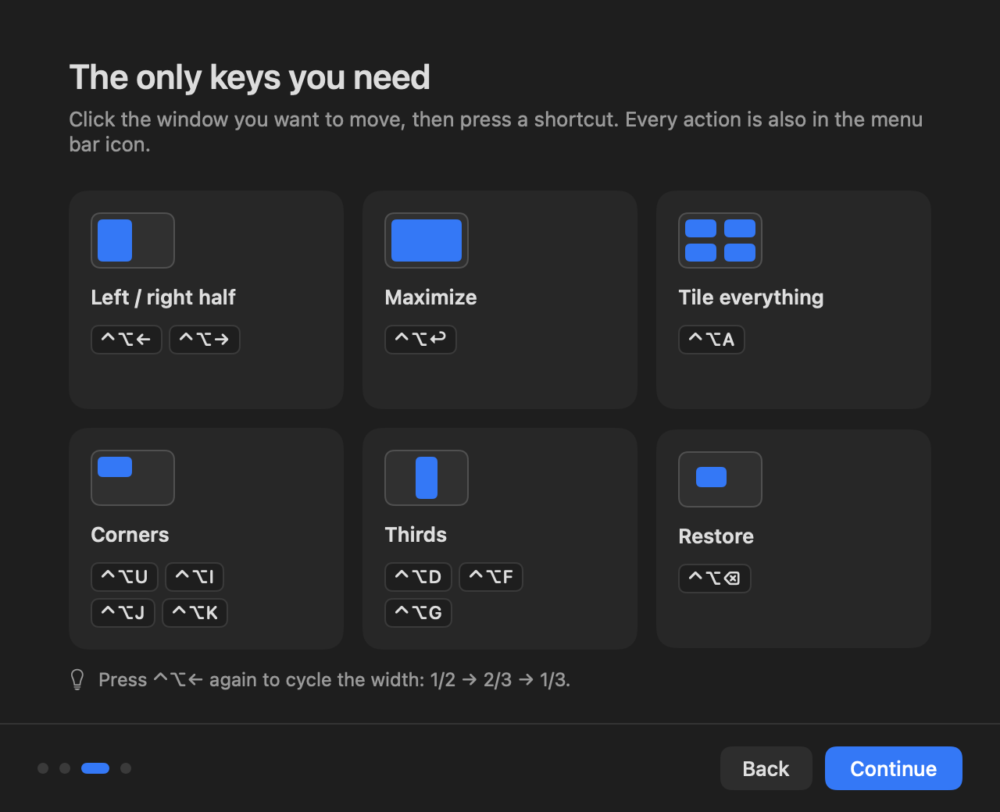
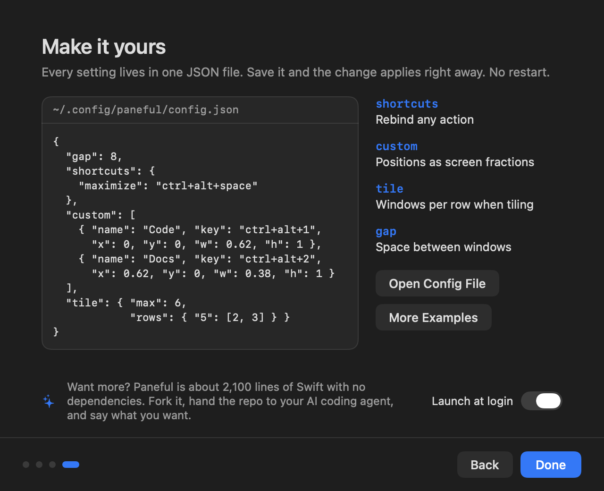

# 分屏 Fenping

一个你能完全读懂、也能完全改写的 macOS 分屏工具。

约 1500 行 Swift,没有任何第三方依赖,不需要 Xcode。所有设置都在一份 JSON 里,保存即生效。想要的功能它没有?Fork 一份,把仓库交给你的 AI 编程助手,让它帮你改。

<p>
  
  
</p>
<p>
  
  
</p>

## 它能做什么

- **键盘分屏**:半屏、四分之一、三分之一、三分之二、最大化、居中、还原、跨显示器。默认快捷键和 [Rectangle](https://github.com/rxhanson/Rectangle) 一致。
- **一键排列**:按 `⌃⌥A`,当前桌面上的窗口自动铺开。2 个左右分,3 个三等分,4 个田字格,5 个上三下二,6 个 3×2。规则可以自己改。
- **自定义位置**:用 0~1 的屏幕比例描述任何你想要的位置,绑上快捷键。
- **拖边吸附**:把窗口拖到屏幕边缘自动贴靠(默认关闭)。
- **菜单栏**:所有动作、开关和配置入口都在菜单栏图标里。
- **首次启动引导**:四步带你完成授权、认识快捷键、学会定制。

## 安装

需要 macOS 13 或更新版本,以及 Swift 编译器。没装过的话先运行 `xcode-select --install`。

```bash
git clone https://github.com/JJ22007/fenping.git
cd fenping
bash build.sh install
```

脚本会编译、跑自测、把 `Fenping.app` 装到 `~/Applications` 并启动。第一次启动会出现引导,按提示在 系统设置 → 隐私与安全性 → 辅助功能 里打开 Fenping 即可。

> **从源码编译的一个坑**:每次重新编译,macOS 都会把它当成新 App,之前的辅助功能授权会失效,而且开关看起来可能还是开着的。解决办法是在辅助功能列表里选中 Fenping 点「−」删掉,再重新打开;或者运行 `tccutil reset Accessibility local.fenping` 后重启 App。如果你有 Apple 开发者证书,用 `SIGN_ID="你的证书名" bash build.sh install` 签名就不会有这个问题。

## 默认快捷键

| 快捷键 | 动作 | 配置里的名字 |
|---|---|---|
| `⌃⌥A` | 一键排列所有窗口 | `tileAll` |
| `⌃⌥←` `⌃⌥→` `⌃⌥↑` `⌃⌥↓` | 左 / 右 / 上 / 下半屏 | `leftHalf` `rightHalf` `topHalf` `bottomHalf` |
| `⌃⌥U` `⌃⌥I` `⌃⌥J` `⌃⌥K` | 左上 / 右上 / 左下 / 右下 | `topLeft` `topRight` `bottomLeft` `bottomRight` |
| `⌃⌥D` `⌃⌥F` `⌃⌥G` | 左 / 中 / 右三分之一 | `firstThird` `centerThird` `lastThird` |
| `⌃⌥E` `⌃⌥T` | 左 / 右三分之二 | `firstTwoThirds` `lastTwoThirds` |
| `⌃⌥↩` | 最大化 | `maximize` |
| `⌃⌥M` | 接近最大化(90%) | `almostMaximize` |
| `⌃⌥C` | 居中 | `center` |
| `⌃⌥⌫` | 还原到分屏前的位置 | `restore` |
| `⌃⌥⌘→` `⌃⌥⌘←` | 移到下一个 / 上一个显示器 | `nextDisplay` `prevDisplay` |

左半屏或右半屏连按,宽度会在 1/2 → 2/3 → 1/3 之间切换。

## 定制

配置文件在 `~/.config/fenping/config.json`,菜单栏 →「编辑配置文件…」可以直接打开。**只需要写你想改的部分**,没写的沿用默认值。保存后一两秒内自动生效。

```json
{
  "gap": 8,
  "dragSnap": false,
  "shortcuts": {
    "maximize": "ctrl+alt+m",
    "center": ""
  },
  "custom": [
    { "name": "写代码", "key": "ctrl+alt+1", "x": 0, "y": 0, "w": 0.62, "h": 1 },
    { "name": "看文档", "key": "ctrl+alt+2", "x": 0.62, "y": 0, "w": 0.38, "h": 1 }
  ],
  "tile": {
    "max": 6,
    "rows": { "5": [2, 3] }
  }
}
```

| 字段 | 含义 |
|---|---|
| `gap` | 窗口之间、窗口与屏幕边缘之间的间距,单位 pt。 |
| `dragSnap` | 是否开启拖边吸附。开启前建议先关掉 系统设置 → 桌面与程序坞 里系统自带的拖边平铺,否则会出现两个预览框。 |
| `shortcuts` | 动作名 → 快捷键。写成 `""` 表示不要这个快捷键。 |
| `custom` | 你自己的位置。`x` `y` `w` `h` 是 0~1 的屏幕比例,原点在左上角。`key` 可以不写,只从菜单里点。 |
| `tile.max` | 一键排列最多排几个窗口。更多的窗口保持不动,优先排最近用过的。 |
| `tile.rows` | 窗口数 → 每行放几个。`"5": [2, 3]` 表示 5 个窗口时上排 2 个、下排 3 个。没写的数量用默认规则。 |

**快捷键写法**:修饰键加一个按键,用 `+` 连接,不分大小写。修饰键有 `ctrl` `alt` `shift` `cmd`;按键可以是字母、数字、`left` `right` `up` `down` `return` `delete` `space` `tab` `escape`、`f1`~`f12` 和常见符号。

**写错了怎么办**:菜单栏顶部会出现「配置有 N 处问题」,点开能看到具体哪里不对。有问题的那一项会被忽略,其余照常工作。也可以在命令行里检查:

```bash
~/Applications/Fenping.app/Contents/MacOS/Fenping --check ~/.config/fenping/config.json
```

### 示例

[`examples/`](examples) 里有几份可以直接抄的配置:

| 文件 | 适合谁 |
|---|---|
| [`minimal.json`](examples/minimal.json) | 只想加一点窗口间距 |
| [`coding.json`](examples/coding.json) | 编辑器占大头,终端和浏览器叠在右边 |
| [`ultrawide.json`](examples/ultrawide.json) | 带鱼屏:中间主区加两条侧栏,一键排列时尽量排成一行 |
| [`vim-keys.json`](examples/vim-keys.json) | 用 H J K L 代替方向键 |
| [`four-only.json`](examples/four-only.json) | 一键排列最多排 4 个,多的不动 |

## 做一个属于你自己的分屏工具

配置文件改不了的,就直接改代码。这个项目是按「方便被人和 AI 读懂、修改」来写的:

1. **Fork** 这个仓库并 clone 到本地。
2. 用你的 AI 编程助手(Claude Code、Cursor、Codex 等)打开它。仓库里的 [`AGENTS.md`](AGENTS.md) 已经告诉 AI 代码结构、怎么编译、怎么验证。
3. **用大白话说你想要什么**,比如:
   - 「加一个快捷键,把当前窗口放到屏幕中间,宽度占 60%,连按在 60% / 80% / 100% 之间切换」
   - 「一键排列时,让我正在用的那个窗口占左边一半,其余的在右边竖着排」
   - 「拖到屏幕底边时,按左中右分成三等分」
   - 「把界面全部改成英文」
4. 运行 `bash build.sh install` 看效果。

想自己动手的话,代码按职责分成了几个小文件:

| 文件 | 职责 | 想改什么时看这里 |
|---|---|---|
| [`Actions.swift`](Sources/Actions.swift) | 内置动作的名字、标题、默认快捷键 | 加一个新动作 |
| [`Geometry.swift`](Sources/Geometry.swift) | 位置计算,全是纯函数 | 改位置、改排列规则 |
| [`WindowManager.swift`](Sources/WindowManager.swift) | 决定哪个窗口去哪 | 改一键排列的分配逻辑 |
| [`Config.swift`](Sources/Config.swift) | 配置文件的读写和校验 | 加一个新的配置项 |
| [`Keys.swift`](Sources/Keys.swift) | 快捷键解析和全局热键 | 支持更多按键 |
| [`DragSnap.swift`](Sources/DragSnap.swift) | 拖边吸附 | 改吸附区域 |
| [`App.swift`](Sources/App.swift) | 菜单栏图标和菜单 | 改菜单 |
| [`Welcome.swift`](Sources/Welcome.swift) | 首次启动引导(SwiftUI) | 改引导界面 |
| [`Accessibility.swift`](Sources/Accessibility.swift) | 读写窗口位置的系统接口 | 一般不用动 |

改完界面后可以运行 `bash build.sh snapshot`,把引导界面的每一步重新渲染到 `docs/`。

## 已知限制

- **不能把窗口移到别的桌面(Space)**,也不能新建桌面。macOS 没有给第三方 App 开放这个接口。
- 全屏、最小化、在其他桌面上的窗口不参与一键排列。
- 有些 App 的窗口有最小尺寸,排不进小格子时会比格子大。
- 没有图形化的快捷键设置界面,快捷键在配置文件里改。

## 致谢

快捷键和交互参考了 [Rectangle](https://github.com/rxhanson/Rectangle)。如果你只是想要一个成熟、开箱即用的分屏工具,直接用它就很好。Fenping 的目标不一样:足够小,小到你可以把它完全变成自己的。

## License

[MIT](LICENSE)

---

**English:** Fenping is a small, dependency-free macOS window tiling tool (about 1,500 lines of Swift) designed to be read, forked, and reshaped. Keyboard halves, quarters and thirds with Rectangle-compatible defaults, one-key "tile everything", custom positions, and a single JSON config that hot-reloads. Build with `bash build.sh install`. The UI is currently in Chinese; see [`AGENTS.md`](AGENTS.md) if you want your coding agent to translate or extend it.
