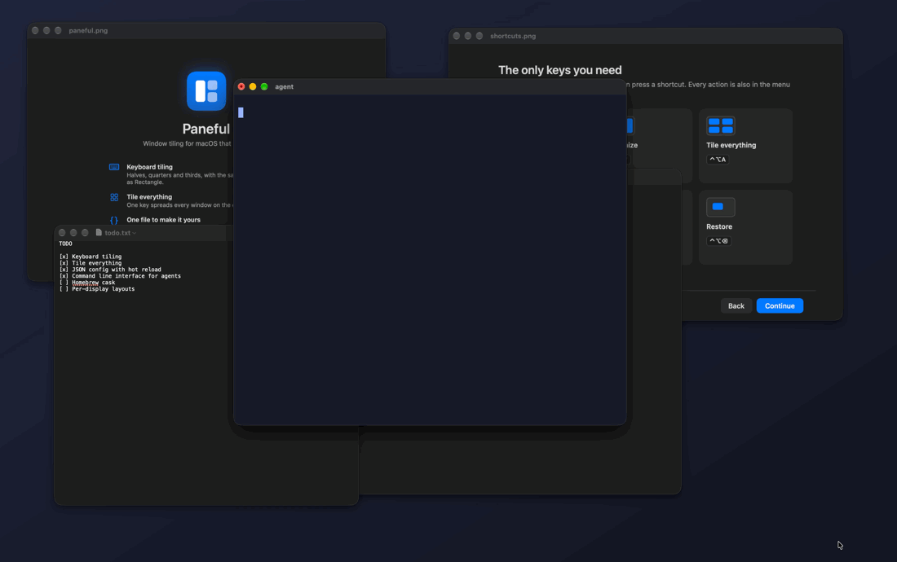

<h1 align="center">Paneful</h1>

<p align="center">
  <b>一个小巧的 macOS 窗口管理器,给你和你的 AI 编程助手拿去 Fork、去改造。</b><br>
  约 2,700 行 Swift,零依赖,一条 <code>swiftc</code> 命令就能编译。自带命令行,agent 可以直接用它帮你摆窗口。
</p>

<p align="center">
  <a href="README.md">English</a>
</p>

<p align="center">
  
</p>
<p align="center"><sub>对 Claude Code 说一句话,杂乱的桌面瞬间归位。真实录屏,agent 思考的几秒做了加速。</sub></p>

Paneful 是一个菜单栏 App,用键盘或者让 agent 把窗口摆到位。它不打算做一个更好的 Rectangle,而是要小到你或你的 AI 编程助手能把它整个读完,再改成你自己的工具:14 个文件、约 2,700 行 Swift,没有第三方依赖,不需要 Xcode 工程,每次编译都会跑一遍自测。

> 界面是英文的,出错和权限提示会跟随系统语言显示中文。想要完整的中文界面?这正好是一个很适合交给 AI 助手的改造任务,见下文「做一个属于你自己的」。

## 该选哪一个

Paneful 只适合少数人,先把实话说在前面。

| 你想要的 | 用这个 |
|---|---|
| 只要半屏、四分之一屏 | 系统自带的就够了:拖到屏幕边缘,或用绿色按钮的菜单 |
| 一个成熟、开箱即用的窗口工具 | [Rectangle](https://github.com/rxhanson/Rectangle):免费,位置多得多,有快捷键录制器,有签名的安装包 |
| i3 / xmonad 式的自动平铺 | [AeroSpace](https://github.com/nikitabobko/AeroSpace)、[Amethyst](https://github.com/ianyh/Amethyst) 或 [yabai](https://github.com/asmvik/yabai) |
| 带 MCP、工作区、截图、OCR 的 agent 工具箱 | [Plonk](https://github.com/ostapondo/Plonk) |
| 一个小到能完全改成自己的窗口管理器,改动交给 agent 来做 | Paneful |

Paneful 拿来交换的是:源码大约 105 KB,只是上面这些工具的一小部分,agent 一次就能读完;[`AGENTS.md`](AGENTS.md) 告诉 agent 每样东西在哪、哪些事它自己验证不了;`paneful` 命令不需要 Node、MCP 配置或 Lua,agent 能跑 shell 命令就能列出和摆放窗口。

## 功能

- **键盘分屏**:半屏、四分之一、三分之一、三分之二、最大化、居中、还原、跨显示器。默认快捷键与 [Rectangle](https://github.com/rxhanson/Rectangle) 一致。
- **一键排列**:按 `⌃⌥A`,桌面上所有窗口自动铺开。2 个左右分,3 个三等分,4 个田字格,5 个上三下二,6 个 3×2。规则可以自己改。
- **自定义位置**:用屏幕比例描述任意位置,绑上快捷键。
- **可以交给 agent**:自带 `paneful` 命令行,脚本和 AI agent 可以列出、摆放、排列窗口。
- **一份配置,保存即生效**:改完保存,一两秒内自动应用。写错了会在菜单里提示,不会把 App 搞坏。
- **拖边吸附**:可选,带实时预览。
- **首次启动引导**:四步完成授权、认识快捷键、学会定制。

## 安装

需要 macOS 13 或更新版本,以及 Swift 编译器。没装过的话先运行 `xcode-select --install`。

```bash
git clone https://github.com/JJ22007/paneful.git
cd paneful
bash build.sh install
```

脚本会编译、跑自测、把 `Paneful.app` 装到 `~/Applications` 并启动。之后按欢迎引导,在 系统设置 → 隐私与安全性 → 辅助功能 里打开 Paneful。

### 或者下载编译好的 App

每个 [Release](https://github.com/JJ22007/paneful/releases) 都附有 **Paneful-universal.zip**(Apple 芯片和 Intel 通用)。解压后把 **Paneful.app** 拖进"应用程序"。它没有经过 Apple 公证:第一次打开如果被拦下,到 系统设置 → 隐私与安全性 里点"仍要打开"。它用的是临时签名,所以每次更新后 macOS 都会要求重新授权辅助功能;按下面的步骤从源码编译就没有这个问题,而且你还能改 Paneful。`SHA256SUMS.txt` 用来核对下载:`shasum -a 256 -c SHA256SUMS.txt`。

### 打算反复编译?先运行一次这个

macOS 把辅助功能权限绑定在 App 的代码签名上。直接从源码编译用的是临时签名,每次重新编译系统都会把它当成新 App:权限失效,而系统设置里的开关可能看起来还是开着的。

```bash
bash scripts/setup-signing.sh
```

这个脚本会在你的登录钥匙串里创建一个自签名证书(只用来给你自己的构建签名),然后重新编译并安装。再授权一次,之后无论怎么重新编译都不会失效。`build.sh` 会自动使用这个证书。

## 默认快捷键

| 快捷键 | 动作 | 配置里的名字 |
|---|---|---|
| `⌃⌥A` | 一键排列所有窗口 | `tileAll` |
| `⌃⌥←` `⌃⌥→` `⌃⌥↑` `⌃⌥↓` | 左 / 右 / 上 / 下半屏 | `leftHalf` `rightHalf` `topHalf` `bottomHalf` |
| `⌃⌥U` `⌃⌥I` `⌃⌥J` `⌃⌥K` | 左上 / 右上 / 左下 / 右下 | `topLeft` `topRight` `bottomLeft` `bottomRight` |
| `⌃⌥D` `⌃⌥F` `⌃⌥G` | 左 / 中 / 右三分之一 | `firstThird` `centerThird` `lastThird` |
| `⌃⌥E` `⌃⌥T` | 左 / 右三分之二 | `firstTwoThirds` `lastTwoThirds` |
| `⌃⌥↩` | 最大化 | `maximize` |
| `⌃⌥M` | 接近最大化(90%) | `almostMaximize` |
| `⌃⌥C` | 居中 | `center` |
| `⌃⌥⌫` | 还原到之前的位置 | `restore` |
| `⌃⌥⌘→` `⌃⌥⌘←` | 向右走 / 向左走:每次半屏,可跨所有显示器 | `nextDisplay` `prevDisplay` |
| `⌃⌥⌘↑` | 跳到下一块显示器:激活那里最前面的窗口,鼠标也移过去,窗口不动 | `focusNextDisplay` |

左半屏或右半屏连按,宽度在 1/2 → 2/3 → 1/3 之间切换。

**跨屏行走。** `⌃⌥⌘→` 每按一次把窗口向右挪半屏:左半屏、右半屏,然后是下一块显示器的左半屏、右半屏,依此类推。`⌃⌥⌘←` 反向走回来。显示器按从左到右排序并首尾相接,所以上下摆放的两块屏也一样能用。如果更想用普通的半屏键做这件事并放弃宽度切换,把 `crossDisplays` 设为 `true`。

**在显示器之间跳。** `⌃⌥⌘↑` 移动的是焦点,不是窗口:它激活下一块显示器上最前面的窗口,并把鼠标移到那个窗口上,接下来的快捷键就作用在那块屏上。这时系统自带的 `⌃←` / `⌃→` 也会切换那块屏的桌面。两块显示器时,按一下切过去,再按一下切回来。

## 定制

配置文件在 `~/.config/paneful/config.json`,菜单栏里点 **Edit Config File…** 可以直接打开。只需要写想改的部分,其余沿用默认值。

```json
{
  "gap": 8,
  "dragSnap": false,
  "shortcuts": {
    "maximize": "ctrl+alt+space",
    "center": ""
  },
  "custom": [
    { "name": "Code", "key": "ctrl+alt+1", "x": 0, "y": 0, "w": 0.62, "h": 1 },
    { "name": "Docs", "key": "ctrl+alt+2", "x": 0.62, "y": 0, "w": 0.38, "h": 1 }
  ],
  "tile": {
    "max": 6,
    "rows": { "5": [2, 3] }
  }
}
```

| 字段 | 含义 |
|---|---|
| `gap` | 窗口之间、窗口与屏幕边缘之间的间距,单位 pt。 |
| `dragSnap` | 拖边吸附。开启前建议先关掉系统自带的拖边平铺(系统设置 → 桌面与程序坞),否则会出现两个预览框。 |
| `crossDisplays` | 默认关闭。开启且接了多个显示器时,左 / 右半屏连按会把窗口移到下一块显示器,不再切换宽度。 |
| `shortcuts` | 动作名 → 快捷键。写成 `""` 表示去掉这个快捷键。 |
| `custom` | 自定义位置。`x` `y` `w` `h` 是 0~1 的屏幕比例,原点在左上角。`key` 可以不写。 |
| `tile.max` | 一键排列最多排几个窗口。其余保持不动,优先排最近用过的。 |
| `tile.rows` | 窗口数 → 每行放几个。`"5": [2, 3]` 表示上排 2 个、下排 3 个。没写的数量用默认规则。 |
| `tile.shapes` | 窗口数 → 排法名:`"columns"`(左右并排)、`"grid"`(每列两个;3 个窗口时是四宫格空一格)、`"gridSidebar"`(网格加侧栏)。`{"3": "grid"}` 让 3 个窗口各自更宽。和 `tile.rows` 同时设置时以 `tile.rows` 为准。 |

**一键排列怎么摆。** 2 个或 3 个窗口左右并排;4 个四宫格;5 个是四宫格加右边一条侧栏;6 个是三列、每列两个。任何数量都可以用 `tile.shapes` 换成别的排法。很多 App 不肯缩到某个最小宽度以下,也有少数(比如系统设置)宽度是固定的。Paneful 摆完会读回每个窗口:哪个窗口比分给它的格子大或小,就按它实际的大小给空间,其余窗口分剩下的,不会有窗口被挤出屏幕,窗口之间也不会留缝。

**快捷键写法**:修饰键加一个按键,用 `+` 连接,不分大小写。修饰键有 `ctrl` `alt` `shift` `cmd`;按键可以是字母、数字、`left` `right` `up` `down`、`return`、`delete`、`space`、`tab`、`escape`、`f1`~`f12` 和常见符号。

**写错了怎么办**:菜单里会出现 "Config Problems",点开能看到具体哪一项有问题。那一项会被跳过,其余照常工作。

[`examples/`](examples) 里有几份可以直接抄的配置:极简、写代码、带鱼屏、Vim 键位、只排四个。

## 让 agent 来操作

Paneful 自带命令行接口。任何能执行 shell 命令的东西都可以替你摆窗口:脚本、启动器,或者 AI agent。

```bash
# 只需一次:把命令放进 PATH
ln -s ~/Applications/Paneful.app/Contents/MacOS/Paneful /usr/local/bin/paneful
```

| 命令 | 作用 |
|---|---|
| `paneful list [--display N] [--app A]` | 列出所有窗口(或只列一部分):App、标题、所在显示器、位置(屏幕比例) |
| `paneful displays` | 列出显示器,从左到右编号 |
| `paneful tile [--display N] [--app A]` | 把所有窗口排成网格,或只排某一块显示器上、某个 App 的 |
| `paneful place 0 0 0.6 1 --app Safari` | 把窗口放到任意位置,四个数字是 `x y w h`,范围 0~1 |
| `paneful run leftHalf --title notes --display 2` | 对指定窗口执行内置动作,可以指定放到哪块显示器 |
| `paneful fullscreen off --app Keynote` | 进入或退出系统全屏 |
| `paneful apply layout.json` | 按 App 或标题一次摆好多个窗口(格式见下) |
| `paneful save` / `paneful restore` | 记下所有窗口的位置,之后一次全部还原 |
| `paneful mcp` | 同样的命令,以 MCP 服务器的形式提供给支持 MCP 的 agent 和工具 |
| `paneful actions` | 列出动作名 |

`--app` 匹配 App 名或 bundle id,`--title` 匹配窗口标题,都是不分大小写的子串匹配;都不写就作用于当前窗口。用 `&&` 串起来可以一次摆好整个布局。

**摆完会核对。** 每次移动后,Paneful 都会向系统读回窗口的真实位置和大小再报告。有的 App 不接受某个尺寸(比如有最小宽度),这一行会标 `differs`,写出要求的和实际的尺寸,agent 就能如实告诉你,而不是说"摆好了"。

**能撤销。** `paneful save` 把所有窗口的位置写到 `~/.config/paneful/layout.json`(也可以指定文件),`paneful restore` 把它们放回去,并报告找不到的窗口。让 agent 动手前先 save,桌面就总能还原。

**整套布局。** `paneful apply` 读一个文件(或用 `-` 从标准输入读),列出每个窗口和要放的位置。每一项取第一个还没用过的匹配窗口;`display` 可省略:

```json
[{"app": "Safari", "x": 0, "y": 0, "w": 0.6, "h": 1},
 {"app": "Notes", "title": "todo", "x": 0.6, "y": 0, "w": 0.4, "h": 1, "display": 2}]
```

**给程序用。** 任何命令加 `--json` 输出 JSON。`list --json` 包含 App、bundle id、标题、显示器、屏幕比例和以点为单位的位置;移动类命令还会带上要求的位置、`matchesTarget`、被跳过的窗口 `skipped` 和总的 `verified`。退出码:0 完成且核实,3 完成但未核实(有窗口不符或被跳过),1 出错,2 Paneful 没在运行。

**MCP。** `paneful mcp` 通过标准输入输出提供 `list_windows`、`list_displays`、`apply_layout`、`tile_all`、`save_layout`、`restore_layout`。每次调用走和命令行同一条通道、同一套回读,没核实的结果一律标为错误。在 MCP 客户端里把命令设为 `paneful`、参数设为 `mcp` 即可。

给你的 agent 几行说明(写进 `CLAUDE.md`、系统提示词,或者直接粘贴),之后正常说话就行:

```markdown
You arrange windows on this Mac with the `paneful` command line tool.
Run `paneful help` to see the commands. Run `paneful save` before you move anything.
Check the output: if a line says "differs", tell me. Act right away, then reply in one short sentence.
```

命令行是和正在运行的 App 通信的,所以 Paneful 需要开着并且已有辅助功能权限;agent 本身不需要任何特殊权限。

**信任模型。** 命令行通过 macOS 的分布式通知把请求发给 App,登录会话里的任何进程都能发这种通知。每个请求都必须带上一个随机令牌,Paneful 启动时把它写到 `~/Library/Application Support/Paneful/cli-token`,只有你的用户能读。沙盒里的 App 读不到它,所以没法借 Paneful 读取窗口标题或移动窗口;你自己运行的非沙盒程序可以,但它们本来就能读你的文件、做更多的事。回复只会写进你自己的临时目录。如果完全不想要这个通道,在自己的 Fork 里删掉 `CLI.startServer()`。更多见 [SECURITY.md](SECURITY.md)(英文),包括 Paneful 读取了什么、怎么报告安全问题。

## 和 Knobs、Overbright 一起用

Paneful 只管窗口。同一个作者还有两个小工具:[Knobs](https://github.com/JJ22007/knobs) 改 macOS 设置(程序坞、触发角、桌面图标、保持屏幕常亮),[Overbright](https://github.com/JJ22007/overbright) 调内建屏幕的亮度。一个 Knobs 配置文件可以同时驱动这三个。比如演示之前:

```json
{
  "knobs": 1,
  "settings": { "awake.display": true, "desktop.icons": false, "dock.autohide": true },
  "overbright": { "percent": 130 },
  "paneful": { "layout": [{ "app": "Keynote", "x": 0, "y": 0, "w": 1, "h": 1 }] }
}
```

```bash
knobs apply present.knobs.json --dry-run   # 先看会改什么
knobs apply present.knobs.json
knobs undo                                 # 设置、亮度和每个窗口一起恢复原样
```

Knobs 调用 `paneful mcp` 和 `overbright mcp`,并列出每个工具读回的结果,你能看到哪些窗口真的移动了。Paneful 的布局写法和 `paneful apply` 一样。完整示例见 Knobs 里的 [`present-keynote.knobs.json`](https://github.com/JJ22007/knobs/blob/main/examples/present-keynote.knobs.json)。三个工具也都能单独用,互不依赖。

## 做一个属于你自己的

配置不够用,就改代码。这个项目是按「方便人和 AI 读懂、修改」来写的。

1. **Fork** 仓库并 clone 你的 fork。
2. 用你的 AI 编程助手(Claude Code、Cursor、Codex 等)打开它。[`AGENTS.md`](AGENTS.md) 已经写清楚了代码结构、怎么编译、怎么验证。
3. **用大白话说你想要什么**,比如:
   - 「加一个快捷键,把窗口居中并占 60% 宽度,连按在 60% / 80% / 100% 之间切换」
   - 「一键排列时,让当前窗口占左边一半,其余的在右边竖着排」
   - 「拖到屏幕底边时吸附成三等分」
   - 「把界面翻译成中文」
4. 运行 `bash build.sh install` 看效果。

[`docs/recipes/`](docs/recipes/README.md) 里有 6 个这样的例子:每个都是一句话交给 Claude Code 改出来的,附完整 diff 和真实窗口上的结果,包括一个没完全做好的。

各源文件的分工见[英文 README](README.md#build-your-own) 里的表格。

## 已知限制

- **不能把窗口移到别的桌面(Space)**,也不能新建桌面。macOS 没有公开的接口。
- 全屏、最小化、在其他桌面上的窗口不参与一键排列。
- 有些 App 的窗口有最小尺寸,可能比分到的格子大。
- 快捷键在配置文件里改,没有图形化的录制界面。这是有意的:配置文件是唯一的设置来源,代码才能保持小。
- 还没有可直接下载的安装包,需要从源码编译;不运行 `scripts/setup-signing.sh` 的话,每次重新编译都会丢掉辅助功能权限。
- 作者只在 Apple silicon、macOS 27、双显示器上测过。Intel Mac 和更早的 macOS 应该能用,但还没试过。

## 致谢

默认快捷键和整体手感参考了 [Rectangle](https://github.com/rxhanson/Rectangle),肌肉记忆可以直接沿用。如果你想要一个成熟、开箱即用的工具,直接用 Rectangle 就很好。Paneful 的目标不一样:小到你可以把它完全变成自己的。

菜单栏图标来自 [Lucide](https://lucide.dev)(ISC 许可,见 [LICENSES/lucide.txt](LICENSES/lucide.txt))。

## License

[MIT](LICENSE)
