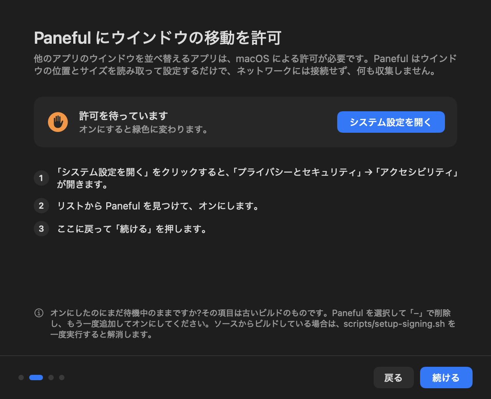

# Recipes: one sentence to an agent, and what came back

Paneful claims to be small enough for a coding agent to reshape. This page is the evidence, including the parts that didn't go perfectly.

Each recipe below is one sentence, given once to Claude Code on a fresh clone. Nobody stepped in, answered questions, or fixed anything afterwards. Then the result was rebuilt independently and, where possible, tried on real windows. Every diff is here, exactly as the agent left it.

## Setup

| | |
|---|---|
| Date | 2026-11-12 |
| Starting point | commit `a5592ae` (branch `cli-readback-and-hardening`) |
| Agent | Claude Code 2.1.322, model `claude-sonnet-5-5`, non-interactive (`claude -p "<sentence>"`) |
| Agent could use | read, edit and write files, `bash build.sh`, `git diff`, `git status`, `ls`, `grep` |
| Agent could not use | `bash build.sh install`, `bash build.sh snapshot`, `rm`, or anything else. Commands outside the list were refused, not asked about |
| Machine | Apple silicon, macOS 27.2, one display |
| Checked afterwards | a fresh `bash build.sh` (compile, self-test, example configs), then real windows through the `paneful` CLI where the change can be driven from it |

## Results

| Recipe | Files | Lines +/− | Agent time | Build and self-test | Real windows |
|---|---|---|---|---|---|
| [Center at 60%, cycle 60 / 80 / 100](#center-at-60-cycling-60--80--100) | 5 | +18 / −4 | 78 s | pass | works |
| [Focused window left, others stacked right](#focused-window-on-the-left-the-rest-stacked-on-the-right) | 5 | +33 / −3 | 79 s | pass | works, with a real-world flaw |
| [Bottom edge snaps to thirds](#dragging-to-the-bottom-edge-snaps-to-thirds) | 2 | +9 / −0 | 48 s | pass | not tried (needs a person dragging) |
| [Japanese interface](#japanese-interface) | 7 | +114 / −97 | 171 s | pass | welcome screens rendered and look right |
| [Leave some apps out of tile all](#leave-some-apps-out-of-tile-all) | 6 | +13 / −2 | 67 s | pass | works |
| [`paneful swap`](#paneful-swap) | 5 | +32 / −5 | 64 s | pass | works |

All six built and passed the self-test on the first try, with no human input. Each added its own self-test checks and updated the README where it changed behavior. "Agent time" is the machine's wall-clock time for the agent run.

**What this does not show.** Six tasks is a small sample, all written by the project's author and all run by one model. "Works on real windows" was checked on one Mac with one display. Treat this as a first data point, not a benchmark.

## Center at 60%, cycling 60 / 80 / 100

> Add a shortcut that centers the window at 60% width and cycles 60% / 80% / 100% when pressed again.

- **What it did:** a new action `centerCycle` on `⌃⌥V`, with the widths in `Geometry.swift`. It noticed that the existing repeat-press logic in `WindowManager.swift` already handles cycling, so it didn't touch that file.
- **On real windows:** four presses gave 60% → 80% → 100% → 60%, full height, centered.
- **Diff:** [`center60.patch`](center60.patch)

## Focused window on the left, the rest stacked on the right

> When tiling all windows, give the focused window the left half and stack the others on the right.

- **What it did:** a pure `focusLeftLayout` function in `Geometry.swift`, used by `tileAll()` on the display with the focused window. Other displays keep the grid.
- **On real windows:** the focused window took the left half and the other five stacked on the right, as asked. **But** with five windows each slot is only about 226 points tall, and four of the apps refused to get that short, so they overlapped. Paneful's read-back caught it: `tiled 6 windows, 4 differ from the requested frame`. The agent did what the sentence said; the sentence didn't anticipate minimum window sizes. A better version would cap the stack, or fall back to a grid on the right.
- **Diff:** [`focusleft.patch`](focusleft.patch)

## Dragging to the bottom edge snaps to thirds

> Dragging a window to the bottom edge of the screen should snap it to thirds, depending on where along the edge you drop it.

- **What it did:** five lines in `DragSnapper.zone(at:in:)`, keeping the corners as quarters, plus a self-test of the new zones.
- **On real windows:** not tried. Drag snapping needs a person dragging with the mouse. The zone logic is covered by the self-test.
- **Diff:** [`bottomthirds.patch`](bottomthirds.patch)

## Japanese interface

> Translate the interface to Japanese.

- **What it did:** extended the existing `L(english, chinese)` helper with a Japanese argument, and translated the menu, all four welcome steps, alerts and config warnings. It shows Japanese when Japanese is the first preferred language.
- **Checked:** the welcome screens rendered in Japanese with `Paneful --snapshot <dir> -AppleLanguages "(ja)"`, and the text fits:

  
- **Note:** the agent wanted to render these screens itself but couldn't (that command wasn't on its list), so it said it hadn't looked at the result. That was the right thing to say.
- **Diff:** [`japanese.patch`](japanese.patch)

## Leave some apps out of tile all

> Add a config option to leave some apps out of tile all, listed by bundle id.

- **What it did:** `tile.exclude` in the config, a warning for an empty entry, two self-test checks, a README line, and an example in `examples/four-only.json`.
- **On real windows:** with `"exclude": ["com.apple.finder"]`, tile all arranged five windows and left the Finder window where it was.
- **Diff:** [`tileignore.patch`](tileignore.patch)

## `paneful swap`

> Add a paneful swap command that swaps the positions of two windows.

- **What it did:** `paneful swap [--app A] [--title T] [--with-app B] [--with-title U]`, defaulting to the focused window and the one behind it. It reused the existing read-back reporting, so `--json` and `differs` work for free.
- **On real windows:** two windows on the left and right halves swapped sides, and both reported their real frames.
- **Diff:** [`swap.patch`](swap.patch)

## What we changed because of this

- Several agents tried to run the self-test or `--check` by hand after `bash build.sh`, which already runs both. [`AGENTS.md`](../../AGENTS.md) now says so, and shows how to render the welcome screens in another language.
- `AGENTS.md` also now asks agents changing tile all to check the read-back from `paneful tile`, since minimum window sizes are what broke the focused-left layout.

## Try one yourself

```bash
git clone https://github.com/JJ22007/paneful.git && cd paneful
claude "Add a config option to leave some apps out of tile all, listed by bundle id."
bash build.sh install
```

If it goes badly, that's useful too. Open an issue with the sentence and what happened.
